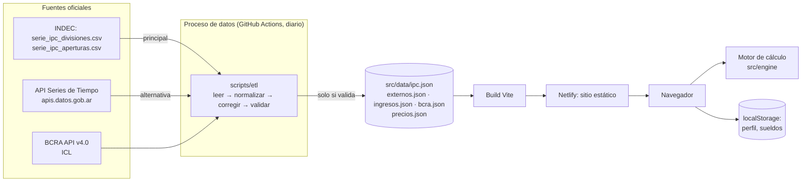

# Arquitectura y modelo de datos

Prioridades: simplicidad, precisión, utilidad y escalabilidad, en ese orden cuando entran en conflicto.

## Fase 1 (construida): sitio estático + proceso de datos



| Capa | Dónde | Responsabilidad |
|---|---|---|
| Frontend | `src/ui` (React 18 + Vite + TypeScript) | Pantallas, gráficos SVG propios, sin librerías pesadas |
| Motor de cálculo | `src/engine` | Funciones puras: períodos, inflación, sueldo, canasta personal, descomposición, simulador. Sin dependencias ni acceso a datos |
| Dominio | `src/domain` | Une datos y motor: regiones, categorías, perfil → canasta, casos de uso, explicaciones, formatos, guardado local |
| Datos oficiales | `src/data/ipc.json` (INDEC), `externos.json` (IPCBA y provincias), `ingresos.json` (salarios, RIPTE, canasta, SMVM, haber mínimo), `bcra.json` (ICL diario, UVA), `precios.json` (precios promedio de INDEC, GBA y regiones) | Generados por el proceso; con metadatos de fuente, fecha, validación y correcciones |
| Servicio de datos | `scripts/etl` | Descarga, normaliza, aplica correcciones conocidas, valida y escribe de forma atómica. Si falla, no toca el archivo vigente; si no hay datos nuevos, no lo reescribe (el workflow no commitea) |
| Autenticación | — | No hay en la fase 1 |

**Por qué así.** Los datos oficiales son públicos, chicos (unos 110 KB) y cambian una vez por mes. No hace falta un servidor para calcular: todo corre en el navegador, sin costo por usuario y sin datos personales en servidores.

**Resiliencia.** El archivo se reemplaza solo si la validación no tiene errores. Si INDEC está caído, se prueba con la API. Si las dos fallan, la web sigue con el último dato válido y muestra su fecha. El workflow de GitHub falla y avisa por mail.

**Rutas.** `/` (calculadora), `/mi-inflacion`, `/comparar`, `/mi-sueldo`, `/precios`, `/alquiler`, `/cuota-uva`, `/inflacion-provincias`, `/panel`, `/ipc-indec`, `/metodologia`. En Netlify, cualquier ruta sirve `index.html` (ver `netlify.toml`). La vista previa autocontenida (`npm run build:preview`) usa anclas (`#comparar`).

**Carga diferida.** `/precios` se carga aparte (`React.lazy`) con su archivo de datos (unos 55 KB comprimidos): el resto del sitio no lo descarga. En la vista previa autocontenida todo queda en el mismo HTML.

## Fase 2: cuentas y sincronización

- **Supabase**: Postgres + Auth (email/contraseña, Google; Apple más adelante) + Row Level Security. No hace falta un backend propio: el cliente habla con Supabase y las políticas garantizan que cada usuario solo ve sus filas.
- Los **datos oficiales siguen como archivo estático**. Las tablas de indicadores oficiales en la base son opcionales; se suman solo si una función de servidor las necesita (por ejemplo, consultas en lenguaje natural).
- **Migración**: al crear la cuenta, se sube lo que había en `localStorage` (el formato ya es el de `exportAll()`).
- **Borrar la cuenta**: una Edge Function con service role elimina `auth.users`, y las tablas borran en cascada.

### Modelo de datos

Las entidades del documento de producto, con lo mínimo necesario:

| Entidad del pedido | Tabla | Nota |
|---|---|---|
| User | `auth.users` | La gestiona Supabase |
| UserProfile | `user_profiles` | 1:1 con el usuario. Sin nombre obligatorio |
| ConsumptionProfile | `consumption_profiles` | Montos en `jsonb` (rubros e ítems); `weights_period` obligatorio |
| ExpenseCategory | `expense_categories` | Tabla de referencia (rubros y subítems → división/subgrupo INDEC) |
| Expense | `expenses` | Historial de gastos. `kind = 'precio_propio'` para contratos (alquiler, prepaga) |
| Income | `incomes` | Sueldos por mes |
| InflationCalculation | `saved_calculations` | Solo si el usuario guarda un cálculo; se puede recalcular |
| Simulation | `simulations` | Supuestos guardados; el resultado se recalcula |
| MonthlyReport | `monthly_reports` | Opcional: solo si se envían por mail; si no, se calcula al vuelo |
| OfficialIndicator / Value, Region | archivo JSON (+ tablas opcionales) | Ver arriba |

```sql
-- Referencia (lectura pública)
create table regions (
  id text primary key,                 -- 'gba', 'pampeana', ...
  name text not null
);
create table expense_categories (
  id text primary key,                 -- 'alquiler', 'prepaga', 'vivienda', ...
  division_id text not null,           -- división COICOP del IPC
  apertura text,                       -- nombre del subgrupo INDEC si existe
  label text not null,
  sort int not null default 0
);

-- Datos del usuario (con RLS)
create table user_profiles (
  user_id uuid primary key references auth.users on delete cascade,
  province_id text,
  conurbano boolean,
  plan text not null default 'free',   -- preparado para premium
  privacy_accepted_at timestamptz,
  created_at timestamptz not null default now()
);

create table consumption_profiles (
  id uuid primary key default gen_random_uuid(),
  user_id uuid not null references auth.users on delete cascade,
  region_id text not null references regions,
  weights_period date not null,        -- primer día del mes al que corresponden los montos
  origin text not null check (origin in ('promedio','manual','ejemplo')),
  amounts jsonb not null,              -- {"vivienda": 700000, "alquiler": 550000, ...}
  is_active boolean not null default true,
  updated_at timestamptz not null default now()
);

create table incomes (
  id uuid primary key default gen_random_uuid(),
  user_id uuid not null references auth.users on delete cascade,
  period date not null,
  net numeric(14,2) not null check (net > 0),
  gross numeric(14,2),
  currency char(3) not null default 'ARS',
  note text,
  unique (user_id, period)
);

create table expenses (
  id uuid primary key default gen_random_uuid(),
  user_id uuid not null references auth.users on delete cascade,
  period date not null,
  category_id text not null references expense_categories,
  description text,
  amount numeric(14,2) not null check (amount >= 0),
  kind text not null default 'gasto' check (kind in ('gasto','precio_propio')),
  source text not null default 'manual' check (source in ('manual','importado')),
  created_at timestamptz not null default now()
);
create index on expenses (user_id, period);

create table saved_calculations (
  id uuid primary key default gen_random_uuid(),
  user_id uuid not null references auth.users on delete cascade,
  kind text not null,                  -- 'equivalente' | 'comparacion' | 'objetivo'
  input jsonb not null,
  data_version text not null,          -- meta.last del IPC usado
  created_at timestamptz not null default now()
);

create table simulations (
  id uuid primary key default gen_random_uuid(),
  user_id uuid not null references auth.users on delete cascade,
  name text,
  input jsonb not null,
  created_at timestamptz not null default now()
);

-- RLS: cada usuario solo ve y modifica sus filas
do $$
declare t text;
begin
  foreach t in array array['consumption_profiles','incomes','expenses','saved_calculations','simulations'] loop
    execute format('alter table %I enable row level security', t);
    execute format('create policy own_rows on %I for all using (auth.uid() = user_id) with check (auth.uid() = user_id)', t);
  end loop;
end $$;
alter table user_profiles enable row level security;
create policy own_profile on user_profiles for all using (auth.uid() = user_id) with check (auth.uid() = user_id);
alter table regions enable row level security;
create policy read_all on regions for select using (true);
alter table expense_categories enable row level security;
create policy read_all on expense_categories for select using (true);
```

## Privacidad

- Separación estricta: los datos oficiales son públicos y estáticos. Los datos personales quedan en el navegador (fase 1) o en tablas con RLS (fase 2).
- No se guarda nada innecesario: no hay nombre, DNI, empleador ni CBU.
- Métricas sin datos financieros: solo páginas vistas y eventos del tipo `calculo_equivalente`, sin montos, con una herramienta sin cookies (Plausible, Umami o Cloudflare Web Analytics).
- Ley 25.326: antes de guardar datos personales en servidores, revisar con un abogado la política de privacidad, el consentimiento, los derechos de acceso y supresión y la inscripción de la base en el registro de la AAIP. Esto no es asesoramiento legal.

## Lenguaje natural (fase 3)

```
pregunta → LLM con herramientas (function calling) → llamadas al motor (officialEquivalent, compareProfile, …) → respuesta con números del motor
```

- El modelo **nunca** calcula ni inventa cifras: solo elige la función y los parámetros, y redacta.
- Corre en una Edge Function, con límite de uso por usuario.
- Requiere avisar que la pregunta y los datos involucrados se envían a un proveedor de IA.

## Monetización futura

`user_profiles.plan` y una función `can(feature)` en el frontend alcanzan para habilitar más adelante informes avanzados, exportación a PDF o más historial. La calculadora y la comparación básica siguen gratis.

## SEO

Las rutas ya son reales y cada una tiene título. El próximo paso es el prerender estático (SSG con `react-dom/server` o `vite-ssg`) para que cada página tenga HTML con contenido explicativo, `<meta description>` y Open Graph. Páginas candidatas: `/calculadora-inflacion`, `/cuanto-deberia-ganar`, `/inflacion-personal`, `/sueldo-real`, `/inflacion-argentina`, `/ipc-indec`, `/canasta-basica`, cada una con contenido propio (sin duplicar páginas).
